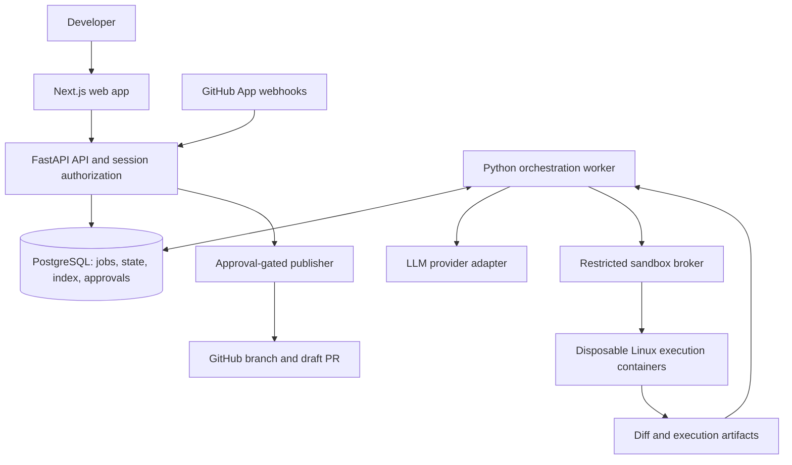

# Forge — master build plan

Plan date: 25 October 2026. Status: proposed design, not an implementation record.

**Later owner amendment:** build as a GitHub App plus browser extension, with a
custom panel inside GitHub and no standalone website. Use only free model access.
The later owner instruction removes Docker: current checks use isolated GitHub
Actions VMs, and the owner confirmed their Groq account is on the Free plan.
See [current implementation scope](IMPLEMENTATION.md) and [verified status](acceptance.md).
The architecture and release boundaries below remain a planning reference where
they do not conflict with those later decisions.

## 1. Mission and product boundary

Build a self-hosted engineering workbench that accepts a GitHub issue, finds the
relevant code, proposes and tests a focused change, and presents its evidence to a
human. Only after that human approves the exact candidate may Forge create a
commit, push a dedicated branch, and open a draft pull request.

The primary user is a developer or small team with an existing repository and a
backlog of bounded bugs or small features. The initial objective is a credible,
measurable portfolio product. Commercial hosting and unrestricted public use are
separate projects.

The experience should answer five questions without reading a raw agent log:

1. What issue is Forge solving, against which repository version?
2. Which files did it choose, and why?
3. What exactly changed?
4. What ran, what passed, and what remains unverified?
5. What am I authorizing when I approve?

Example: a user submits an issue reporting that `/users?limit=0` incorrectly
returns a successful response. Forge locates the route, validation, and existing
tests; reproduces the bug; adds validation and a regression test; runs the checks;
and shows the patch. The user approves it, then receives a draft PR with the
recorded test results and issue reference.

### What carries over from the earlier projects

| Reference | Principle to reuse in Forge |
| --- | --- |
| Bhagavad Gita / Open Scripture build plan | Explicit ground rules, a concrete repository layout, incremental milestones, and acceptance checks before expanding scope. |
| Open Scripture finalized scope | Keep the actual product focused; maintain a clear implemented/pending record rather than treating a package or research note as a working feature. |
| PolicyLens | Link inputs, evidence, proposed actions, approvals, and outcomes in one traceable workflow. Agents prepare work; people authorize consequential changes. |

These are workflow principles. The other projects' domain rules, infrastructure,
accounts, deployment hosts, and licenses do not automatically apply to Forge.

## 2. Ground rules

1. No generated Git commits, pushes, or PR creation before approval of the exact
   patch. Before approval, keep ordinary uncommitted files and immutable patch
   artifacts; do not use hidden checkpoint commits.
2. Never merge a PR, force-push, change the default branch, deploy the target
   application, or modify repository settings automatically.
3. Repository contents, issue text, comments, test output, and dependency scripts
   are untrusted input. They cannot override Forge's permissions or policies.
4. Target repository code never executes in the API, orchestrator, or publisher
   process. Installing dependencies also counts as executing untrusted code.
5. GitHub credentials, LLM keys, database credentials, and host secrets never enter
   a target-code execution container.
6. Every run pins its base commit, issue snapshot, model configuration, tool policy,
   environment profile, and budget. Repository citations use that commit and lines.
7. A model cannot declare tests passed. The runner records commands, exit codes,
   durations, timeouts, and artifacts; the interface distinguishes those facts from
   model interpretation.
8. Failing baseline tests, skipped checks, unavailable services, and zero collected
   tests stay visible. Never silently convert them into a green result.
9. Work on the target repository happens in an isolated disposable workspace.
   Never edit the user's original checkout.
10. Time, token, tool, patch-size, and retry budgets are enforced outside the model.
11. Approval is invalidated by a changed patch, relevant base revision, execution
    policy, or validation evidence. The model cannot approve its own work.
12. A milestone is done only when its exit checks pass and its limitations are
    documented. Development commits to Forge itself follow the owner's normal
    instructions; this plan does not authorize committing anything now.

## 3. Release scope

### Initial working demo: one complete issue-to-PR journey

- Sign in, install a GitHub App, and select an authorized repository.
- Paste an issue URL; fetch and freeze its content and the selected base SHA.
- Index source files, symbols, tests, documentation, and project configuration.
- Produce a concise plan with file/line citations and acceptance criteria.
- Use distinct planner, coder, tester, and reviewer roles.
- Apply a patch in a disposable workspace and run the configured checks.
- Allow an initial coding attempt and at most two repair cycles.
- Show live progress, candidate diff, test evidence, cost usage, and limitations.
- Approve, reject, or request a revision of the candidate.
- After approval, commit and push a dedicated branch and create a draft PR.
- Cancel runs, recover interrupted jobs, and download a patch without publishing.

### Supported repository profiles

Start with one Python profile using pytest and one TypeScript profile using the
repository's configured package manager and test runner. Support small
single-project repositories first. Add monorepos only after both profiles pass the
same end-to-end suite.

Initial configurable limits: 10,000 tracked files, 50 MB eligible source text,
500 KB per indexed text file, and one active run per installation. Larger repos
receive a clear unsupported-size result or a user-selected subtree.

Public and private repositories may be connected only when the installation and
signed-in user are authorized. Begin acceptance testing with owned public fixture
repositories. Enable private source access after authorization, storage, and
provider disclosure checks pass.

### Explicitly deferred

Arbitrary anonymous repositories; organization-wide unattended issue picking;
automatic merges; cross-repository changes; production deployments; mobile and
desktop apps; voice control; billing; enterprise SSO; custom model training;
Kubernetes; unrestricted internet browsing by agents; and simultaneous competing
patches from many coding agents.

Workflow files, deployment files, dependency manifests/lockfiles, authentication
and secret-handling code, and migrations are protected paths in the first release.
Forge may analyze them, but editing requires an explicit run policy selected by a
human; otherwise it returns a blocked proposal explaining the required change.

## 4. User experience

Use three main destinations: **Repositories**, **Runs**, and **Settings**. Keep
approvals inside the run that produced the candidate. No separate agent-management
dashboard is needed for the first version.

| Screen | User action and information |
| --- | --- |
| Repositories | Connect installation, see accessible repositories, configure a trusted execution profile, index a revision, inspect index freshness. |
| New run | Select repository, paste issue, see scope and budget, choose base branch, and start. Issue ingestion alone never starts execution. |
| Run detail | Read the issue and plan, follow concise progress events, inspect relevant files, and see current budget and stop reason. |
| Changes | Review file diff, added/deleted lines, protected-path warnings, and rationale linked to the issue. |
| Validation | See baseline versus candidate results, regression checks, exact commands, collected test counts, logs, and unverified requirements. |
| Review | Approve the displayed candidate, reject it, request a bounded revision, or download the patch. |
| Published result | Open the draft PR, inspect commit SHA and CI status, and see any publication error that needs recovery. |
| Settings | Manage installation, provider credentials, budgets, retention, and repository profiles. Show secrets only as configured/missing. |

Use a code diff viewer, keyboard-accessible controls, readable status labels, and
mobile access for review. Show useful summaries first; raw tool events are
expandable. Avoid invented confidence percentages and theatrical agent chat.

The approval button must say **Approve patch and create draft PR**. Before it,
show the base SHA, candidate fingerprint, changed files, validation summary,
destination branch, and potential CI side effects. Approval is to publish this
candidate; merging remains a separate action in GitHub.

## 5. Architecture and stack



| Layer | Proposed choice | Reason |
| --- | --- | --- |
| Web | Next.js App Router, TypeScript, Tailwind, accessible component primitives | A usable review interface with strong diff and streaming support. |
| API | Python, FastAPI, Pydantic, generated OpenAPI | Typed API boundary and straightforward Python agent tooling. |
| Persistence | PostgreSQL, SQLAlchemy, Alembic | Transactions for state changes, approvals, job leases, and publication recovery. |
| Retrieval | File paths/symbols and PostgreSQL full-text search first; pgvector later | Exact code identifiers matter; semantic retrieval is an evaluated enhancement. |
| Jobs | Separate Python worker with PostgreSQL job table, leases, and heartbeats | Durable work without Redis/Celery infrastructure in the first release. |
| Agent orchestration | Explicit persisted state machine and typed role outputs | Easy to inspect, test, recover, and keep within policy. |
| Execution | Hardened Linux Docker containers behind a narrow broker on a dedicated worker VM | Reproducible environments and a clear execution boundary. |
| GitHub | GitHub App plus user sign-in; trusted checkout/publish broker | Repository-scoped access and separation from target execution. |
| Models | Provider interface for structured output, tools, embeddings, usage, and cancellation | Change providers without rewriting orchestration; no dependency on one model name. |
| Progress | Persisted run events streamed through Server-Sent Events | Reconnect using event IDs and replay missed events. |
| Artifacts | Local encrypted storage for the single-host pilot; object-storage adapter later | Keep immutable patches and logs outside the primary request path. |
| CI | GitHub Actions for Forge's own checks and fixture acceptance | Repeatable evidence of the engineering work. |

Pin supported runtime and dependency versions in milestone M0 after checking
current compatibility. Do not depend on floating `latest` container tags or
unversioned model aliases in evaluation records.

Use actual background workers for long runs. FastAPI's documentation distinguishes
in-process background tasks from heavier work that benefits from separate
processes. PostgreSQL supplies the durable queue in this proposed design;
Celery is an alternative only if later scale warrants it.
[FastAPI background tasks](https://fastapi.tiangolo.com/tutorial/background-tasks/)

For a later semantic index, pgvector explicitly supports combination with
PostgreSQL full-text search. Keep file-path and symbol matches alongside vectors.
[pgvector hybrid search](https://github.com/pgvector/pgvector#hybrid-search)

## 6. Repository layout to create during implementation

```text
Forge/
  README.md
  AGENTS.md                       # implementation rules, added in M0
  pyproject.toml / uv.lock
  package.json / pnpm-lock.yaml / pnpm-workspace.yaml
  apps/
    web/                          # Next.js: repositories, runs, review
    api/                          # FastAPI: auth, API routes, SSE
    worker/                       # durable job loop and orchestration
    publisher/                    # trusted GitHub write operations
  packages/
    forge_core/                   # state machine, budgets, policy, contracts
    forge_agents/                 # planner, coder, tester, reviewer
    forge_index/                  # inventory, symbols, retrieval
    forge_sandbox/                # broker protocol and execution profiles
    forge_github/                 # installation auth, checkout, webhooks, PRs
    forge_llm/                    # providers, structured output, metering
    forge_db/                     # models, queries, Alembic migrations
    api_client/                   # generated TypeScript API client
  tests/
    unit/
    integration/
    security/
    e2e/
  evaluation/
    cases/                        # frozen issue/base SHA/expected outcomes
    fixtures/                     # small owned repositories
    harness/                      # external regression checks and scoring
    results/                      # sanitized, versioned evaluation summaries
  infra/
    compose.yaml
    docker/
    sandbox-profiles/
    deployment.md
  docs/
    MASTER_PLAN.md
    FEATURE_SCOPE.md
    acceptance.md
    threat-model.md
    operations.md
    decisions/
  .github/workflows/
```

Use a single Python workspace and a pnpm workspace. Generate frontend API types
from OpenAPI instead of manually maintaining parallel Python and TypeScript
contracts. Add real packages as milestones need them; do not create dozens of
placeholder modules or meaningless passing tests.

## 7. Agent roles and contracts

Multi-agent means distinct model invocations with explicit responsibilities,
contexts, tool permissions, and recorded outputs. It does not require different
providers or simultaneous execution. The first version runs these roles mostly
sequentially against one candidate to avoid workspace conflicts.

| Role | Inputs and output | Permissions |
| --- | --- | --- |
| Planner | Frozen issue + retrieved code → acceptance criteria, cited file shortlist, steps, risks, and check plan. | Search/read; cannot edit files, execute code, or publish. |
| Coder | Approved run scope + plan + context → focused patch and explanation. | Read/edit candidate files inside policy; request sandbox checks; cannot obtain credentials or call GitHub writes. |
| Tester | Issue criteria + baseline/candidate + runner evidence → proposed regression tests and structured result analysis. | Add tests through the patch policy and request configured checks; cannot weaken protected checks or publish. |
| Reviewer | Issue + final diff + evidence → findings tied to files and unmet criteria. | Read only; cannot change the candidate, grant approval, or override deterministic gates. |

The orchestrator is ordinary application code, not another all-powerful LLM. It
validates role outputs, enforces permissions, selects the next state, reserves
budget, and decides whether a repair is permitted.

Useful tools: `search_code`, `read_file`, `find_symbol`, `find_references`,
`apply_patch`, `run_profile_check`, and `inspect_result`. Each has a validated
schema, path bounds, output limit, and audit event. There is no model-accessible
`approve`, `git_push`, arbitrary host shell, or direct Docker command.

If a new regression test is added, run it against the unchanged base and the
candidate when feasible. A meaningful reproduction fails on the base for the
expected reason and passes on the candidate. Report when a feature cannot be
evaluated that way. A tester role using the same model is not independent proof
of correctness; the evaluator and deterministic checks provide additional evidence.

## 8. Run lifecycle, retry policy, and recovery

```text
QUEUED → SNAPSHOTTING → INDEXING → BASELINE → PLANNING → CODING
  → VALIDATING → REVIEWING → AWAITING_APPROVAL
  → PUBLISHING → PR_OPENED

Validation/review failure → REPAIRING → VALIDATING (at most two repair cycles)

Any pre-publication state → CANCELLED / FAILED / NEEDS_INPUT / BUDGET_EXCEEDED
Rejection → REJECTED
Changed base or candidate → STALE, then revalidation and a new approval
```

Distinguish infrastructure retries from code repairs. Retry transient provider
timeouts, rate limits, and network failures with bounded backoff and
`Retry-After` support. Never repeatedly retry invalid credentials or a deterministic
permission denial. Repeated identical test failures stop with a useful summary.

Initial defaults, to tune using measured fixture runs:

| Limit | Initial policy |
| --- | --- |
| Active runs | One per installation |
| Code repair cycles | Two after the initial attempt |
| Model calls | 20 per run |
| Total model tokens | 100,000 across input and output, with per-call caps |
| Whole-run execution window | 20 minutes, excluding human approval wait |
| Individual check | 3 minutes unless a human configures another profile |
| Patch size | 10 files and 500 changed lines; larger work needs rescoping |
| Log retention per command | Bounded capture, with explicit truncation flags |

A human may set a tighter currency cap. Reserve estimated maximum cost before
each model call; record actual usage afterward. Price configuration has a date and
source, and unknown pricing must not appear as zero cost. Report compute usage
separately from provider charges.

The worker claims jobs with a lease and persists each transition. A crashed worker
can be replaced after lease expiry; stale workers cannot publish using an expired
lease. Use an outbox for durable events and publication intents. External side
effects use stable run/candidate keys and reconciliation, rather than an assumption
of exactly-once delivery.

Cancellation kills the sandbox process group, prevents new tool/model calls, and
preserves evidence already collected. If a GitHub write is already in flight,
reconcile and report what actually happened; cancellation cannot retroactively
erase an external request.

## 9. Repository indexing and codebase understanding

1. Fetch a clean archive or checkout at a specific SHA through trusted GitHub code.
   Disable hooks, submodules, external filters, and LFS fetching by default.
2. Reject unsafe paths, symlink escapes, oversized archives, and zip-bomb expansion.
   Never clone arbitrary user-provided URLs; resolve owner/repo via authorized
   GitHub repository IDs to avoid SSRF.
3. Inventory tracked text files. Exclude `.git`, generated output, dependencies,
   binaries, environment files, credentials, and user-denied paths.
4. Capture file hashes, language, symbols, imports, exports, and line ranges. Start
   with Python AST and a TypeScript parser; parser errors fall back to bounded text
   chunks and are visible in index status.
5. Retrieve using issue identifiers, path and symbol matches, full text, neighboring
   definitions, tests, and imports. Feed a bounded context bundle to the planner.
6. Store citations as repository ID + commit SHA + path + line range + content hash.
7. Add semantic chunks and pgvector only after a retrieval evaluation demonstrates
   a benefit. Model/version identity is part of embedding cache keys.
8. Reuse unchanged file records on later commits. Never reuse context across
   repositories or installations without explicit authorization checks.

The claim is useful code retrieval, not complete understanding of every language
or an exhaustive dependency graph. Measure whether the expected files appear in
the retrieved top results on labeled cases.

## 10. Sandboxed execution and trust boundaries

### Execution design

The API and publisher run on a control host. Target-code containers run on a
dedicated Linux worker VM with no production secrets and no inbound route to the
control database or administrative network. Local development uses Docker Desktop
with its Linux/WSL2 environment; acceptance happens on the Linux worker profile.

Only the sandbox broker controls the daemon. It exposes fixed operations for
starting approved images, running bounded commands, collecting artifacts, and
destroying workspaces. It rejects arbitrary mounts, image names, privileged flags,
host namespaces, and network choices. Neither API nor target container receives
the Docker socket.

Per container: non-root user, read-only root filesystem, writable scratch/workspace
only, dropped capabilities, `no-new-privileges`, default seccomp, no host devices,
and CPU/memory/PID/disk/time limits. Verify that the actual host enforces these
limits; rootless configuration alone is not evidence that every limit works.

Docker documents rootless mode and syscall restrictions, while also explaining
the power of daemon access. These controls reduce risk; containers share a kernel.
This plan therefore limits the pilot to explicitly authorized repositories on a
disposable worker host. Public hostile-code hosting requires a separate isolation
review and a stronger boundary such as microVMs or a vetted sandbox service.
[Docker security](https://docs.docker.com/engine/security/),
[rootless mode](https://docs.docker.com/engine/security/rootless/),
[seccomp](https://docs.docker.com/engine/security/seccomp/)

### Dependency installation and networking

Use prebuilt pinned Python and Node profiles. Resolve locked dependencies in a
separate disposable preparation sandbox with narrow outbound access to configured
registries or an artifact proxy. Block private address ranges, cloud metadata,
host services, and arbitrary redirects at the network boundary.

Disable install lifecycle scripts by default. If a supported repository needs a
build script, a human configures that exact behavior; it still runs without secrets
inside the isolated preparation environment. Private package credentials and
arbitrary target Dockerfiles are outside the first release.

Validation containers have network disabled. Share only bounded dependency caches
keyed by lockfile, image digest, and installation; do not let one run poison another
installation's cache. Reproducible online integration tests are a later explicit
profile, not a silent fallback when offline tests fail.

### Tool and artifact safety

Normalize paths and check real paths before reads/writes. Reject traversal,
absolute external paths, unsafe symlinks, and excessive output. Prefer structured
argv over shell strings. An allowlisted `pytest` or package script still executes
arbitrary repository code, so the sandbox remains the actual execution boundary.

Collect artifacts through bounded reads; treat HTML, Markdown, SVG, and terminal
escapes as untrusted when rendering. Scan patches and artifacts for likely secrets,
redact logs, and state that scanning cannot guarantee absence of sensitive data.

Repository instruction files may inform style and test discovery but cannot
change Forge's tool permissions. Target-side executable configuration is treated
as code. Execution profiles are stored in Forge and changed by humans, not by
accepting an agent-modified config from the candidate.

## 11. Approval, commit, and pull request protocol

This is the product's most important correctness boundary.

1. Freeze a candidate: base SHA, exact patch bytes, resulting tracked-file hashes,
   execution profile, validation result digests, and reviewer findings. Calculate
   a canonical SHA-256 candidate fingerprint.
2. Mark it `AWAITING_APPROVAL`. Further edits create a new candidate version.
3. An authenticated human with current repository permission approves that exact
   fingerprint. Enforce session/CSRF protections, expiry, and one-use authorization.
4. The publisher verifies the stored approval, job ownership, current installation,
   target repository access, artifact hashes, and current base branch SHA.
5. If the base moved, refuse publication. Refresh/rebase in a sandbox, rerun the
   required checks, and request approval of the new candidate.
6. Reconstruct a fresh trusted checkout at the approved base, apply only the
   approved patch, and verify the resulting tree. Do not trust a `.git` directory,
   hooks, or executable metadata supplied by the sandbox. Do not run target code
   in the publisher.
7. Create the first generated commit, push `forge/issue-<number>-<run-id>`, and open
   a draft PR. The branch prefix is a proposed product default, configurable later.
8. Store commit SHA, branch, PR number, and URL. On interruption, reconcile the
   expected branch/tree and existing PR before retrying. Never create duplicates
   or force-push an unexpected branch.

For the initial release, block publication when required checks fail or are
unavailable. The human can still download the candidate patch with the failure
report. An override workflow can be designed separately if users demonstrate a
need; do not quietly add one to the first version.

The PR body contains the issue link, change summary, exact validation results,
known limitations, run/candidate reference, and model provenance. Do not claim a
check ran if it did not. Use an issue reference rather than an automatic closing
keyword by default.

GitHub App permissions: metadata read, contents read/write for publication,
issues read, and pull requests read/write. Add Actions/checks read only if the
release displays remote CI results. No administration, secrets, workflow-write,
or issue-comment write permission is required for the initial scope. A short-lived
read-scoped installation token serves checkout; only the publisher may mint the
necessary write-scoped token. Installation tokens can be narrowed to specific
repositories and permissions, and currently expire after one hour.
[GitHub installation authentication](https://docs.github.com/en/apps/creating-github-apps/authenticating-with-a-github-app/authenticating-as-a-github-app-installation)

Validate webhook HMAC signatures on the raw request bytes and deduplicate delivery
IDs. An authentic webhook is still not authorization for an arbitrary issue author
to spend money or change code; run creation needs a signed-in authorized user.
[GitHub webhook validation](https://docs.github.com/en/webhooks/using-webhooks/validating-webhook-deliveries)

Creating a draft PR uses GitHub's documented pull-request API. Check repository
capabilities and report permission or plan restrictions; do not silently publish
a normal PR if a draft is unavailable.
[GitHub pull request API](https://docs.github.com/en/rest/pulls/pulls#create-a-pull-request)

**CI side effect:** pushing a branch or opening a PR can trigger repository
workflows, and same-repository branches may have access to secrets. Before enabling
publication, review the fixture/target CI configuration and require a safe policy
without automatic privileged deployments. Draft status alone does not provide
isolation. Never run untrusted head code under privileged `pull_request_target`.
[GitHub runner security](https://docs.github.com/en/actions/concepts/security/compromised-runners),
[pull_request_target guidance](https://docs.github.com/en/actions/reference/security/securely-using-pull_request_target)

## 12. Data model and API outline

All repository-owned rows carry installation/repository scope, with authorization
enforced server-side for metadata, search, logs, downloads, events, and writes.

| Table | Core data |
| --- | --- |
| users / sessions | GitHub user identity, secure session state, expiry and revocation. |
| installations / memberships | GitHub installation identity, current repository grants, user access checks. |
| repositories / execution_profiles | GitHub IDs, default branch, trusted checks, protected paths, limits. |
| snapshots / indexed_files / symbols / chunks | Base SHA, eligible content hashes, source citations, search metadata. |
| issues | Frozen title/body/reference, content hash, retrieval time. |
| runs / jobs | State, lease/version, budget reservations, stop reason, profile/config versions. |
| agent_steps / tool_calls | Role, provider/model, input/output references, usage, policy decisions. |
| candidates / artifacts | Immutable patch fingerprint, tree hashes, artifact location and digest. |
| check_results | Baseline/candidate identity, argv, exit code, count, duration, image digest, log reference. |
| approvals | Human identity, exact candidate fingerprint, action, timestamp, expiry, consumption. |
| publication_intents | Candidate, branch, expected commit/tree, reconciliation state, PR URL. |
| webhook_deliveries / run_events / outbox | Deduplication, ordered progress, audit records, reliable delivery. |

Suggested API surface:

```text
GET    /auth/github/start
GET    /auth/github/callback
POST   /auth/logout
GET    /api/repositories
POST   /api/repositories/{id}/index
PUT    /api/repositories/{id}/execution-profile
POST   /api/runs                         # issue URL, repository ID, base, budget
GET    /api/runs/{id}
GET    /api/runs/{id}/events              # SSE with resumable event IDs
GET    /api/runs/{id}/candidates/{version}
GET    /api/runs/{id}/checks
GET    /api/runs/{id}/artifacts/{artifact_id}
POST   /api/runs/{id}/cancel
POST   /api/runs/{id}/request-revision
POST   /api/runs/{id}/approve             # exact fingerprint + idempotency key
POST   /api/runs/{id}/reject
POST   /api/webhooks/github
GET    /health/live
GET    /health/ready
```

There is no public unauthenticated execution endpoint. Enforce idempotency on run
creation and approval, rate-limit expensive operations, and validate installation
grants again before publication. Removing access blocks new work immediately and
triggers the configured source/artifact deletion workflow.

## 13. Implementation milestones and acceptance gates

Planning estimate: roughly 6–8 focused development weeks for a convincing pilot,
with additional time for private repositories and broader hardening. This is an
estimate for one developer assisted by coding tools, not a delivery promise.

### M0 — Contracts, fixture repositories, and runnable foundation

Create the workspace, CI, FastAPI health endpoint, Next.js shell, database
migrations, local Compose setup, and typed API client. Write the threat model,
execution-profile schema, state transition rules, candidate format, and budget
contract. Create owned Python and TypeScript fixture repositories with seeded
issues and known expected changes. Use fake provider responses for CI.

**Exit:** a clean checkout starts with documented commands; the UI shows real API
health; migrations apply; meaningful contract checks pass; fixture issues and
expected outcomes are recorded before agent work.

### M1 — GitHub connection and read-only repository intelligence

Implement sign-in, installation/repository authorization, webhook validation,
safe snapshotting, inventory, symbol extraction, lexical search, and cited file
retrieval. Show index status and issue preview in the UI.

**Exit:** a known fixture issue retrieves its expected implementation and test
files; every citation opens the pinned revision; another installation cannot read
the index, issue snapshot, events, or artifacts; malformed archives and spoofed
webhooks are rejected.

### M2 — Reproducible sandbox and baseline checks

Implement the restricted broker, preparation and execution containers, dependency
profiles, network controls, limits, cancellation, cleanup, artifact capture, and
the baseline/candidate check-result format. Do this before allowing model patches.

**Exit:** both fixture profiles run real checks; timeouts, memory/PID/disk limits,
network denial, secret isolation, cancellation, and cleanup are demonstrated on
the acceptance host. Missing dependencies and zero-test runs are honest failures.

### M3 — One complete autonomous coding loop

Implement planner and coder, bounded repository tools, patch policy, deterministic
validation, candidate artifacts, and live run progress. Complete the Python
issue-to-reviewed-patch journey first, then repeat it for TypeScript.

**Exit:** a real configured model produces a focused patch on each profile and
the runner verifies it. Nothing is committed or pushed. A provider outage and a
nonreproducible issue produce understandable terminal outcomes.

### M4 — Tester, reviewer, repairs, and durable recovery

Add the separate tester and reviewer contracts, regression checks on base and
candidate, bounded repair decisions, provider metering, job leases, outbox events,
SSE reconnection, and crash/cancellation handling.

**Exit:** a seeded first-attempt failure is repaired within limits; a persistent
failure stops; a worker restart resumes safely; two workers cannot own the same
step; logs and check counts remain consistent after reconnection.

### M5 — Human approval and draft PR publishing

Build the diff/check review UI, canonical candidate fingerprint, approval API,
trusted publisher, GitHub branch/PR creation, and reconciliation. Inspect CI
side effects on the fixture repositories before enabling writes.

**Exit:** attempts to publish before approval, reuse approval, edit an approved
candidate, swap an artifact, publish to another repository, or publish after the
base moves are denied. One exact approved candidate creates one draft PR. A crash
after branch creation or PR creation does not create duplicates.

### M6 — Evaluation, usable demo, and hosted pilot

Populate example runs, polish error and empty states, run keyboard/mobile review
checks, add operations metrics, backups and restore rehearsal, deployment docs,
and a reproducible evaluation report. Deploy the control plane and worker on
separate hosts or equivalent isolated environments; do not share a production
host or credentials with PolicyLens or Open Scripture.

**Exit:** complete the release checklist below using real end-to-end runs,
publish measured results and known failures, and make the owner acceptance
journey reproducible. Private repositories remain disabled until their specific
access, retention, and provider-data checks pass.

## 14. Evaluation and release criteria

### Engineering tests

- Unit: state transitions, budget reservations, role output validation, path rules,
  candidate hashing, protected paths, and permission decisions.
- Integration: migrations, job leases, webhook replay, provider failures, snapshot
  ingestion, Docker profiles, approvals, publication reconciliation.
- Security: prompt injection in issues/files/logs, traversal and symlinks, cross-user
  access, source leakage, sandbox egress, secret isolation, malicious artifacts,
  cache poisoning, stale approvals, and duplicate external writes.
- End to end: connect fixture repository → issue → patch → real tests → review →
  approve → draft PR; include failure, revision, cancel, and restart paths.

Deterministic fake-provider CI verifies product behavior. A separate explicitly
configured live-model suite verifies that the actual agent can solve tasks. A fake
response and a mocked GitHub API do not count as a live model or published PR.

### Agent evaluation set

Create 20 labeled tasks: 8 Python fixes, 8 TypeScript fixes, and 4 tasks requiring
clarification or refusal because of ambiguity or protected scope. Keep expected
solutions and evaluator tests outside the agent's retrieval/tool context. Reserve
some tasks as a holdout and record changes to the dataset to reduce tuning leakage.

On a candidate, run external evaluator tests inside the same code-isolation
boundary, with no evaluator infrastructure credentials available to target code.
Record task ID, base SHA, model ID, prompt/tool versions, image digest, costs, time,
repairs, changed files, and outcome. A green repository suite alone is insufficient
when it never checked the issue's requirement.

Publish:

- Functional success on the 16 solvable tasks, with raw numerator and denominator.
- Correct clarification/refusal outcomes on the 4 out-of-scope tasks.
- Relevant-file retrieval recall in the top results.
- First-attempt success versus success after repairs.
- Regressions introduced, reviewer findings, and unsupported checks.
- Median and tail run duration, provider cost, and token usage.
- Unauthorized actions attempted/blocked and publication/recovery failures.

Initial advancement target: at least 12 of 16 solvable tasks pass external checks,
all 4 scope cases stop appropriately, and all deterministic authorization and
approval tests pass. This is a development target, not a claimed result or a
statistical guarantee. Repeat selected tasks to show variability before claiming
reliability. If the target is missed, keep Forge labeled experimental and use
patch-download demos while improving retrieval, profiles, or task scope.

### Release checklist

1. Real Python and TypeScript issue-to-draft-PR journeys work on owned repositories.
2. No pre-approval commit/write path exists in the exposed tool set or publisher.
3. All recorded required checks are real, attributable to the candidate, and pass.
4. A moved base, revoked access, stale candidate, or tampered artifact stops publish.
5. Cancel, timeout, worker restart, and publication retry have observed outcomes.
6. Deployment enforces tested isolation and network/resource limits.
7. A database and artifact restore has been rehearsed in a clean environment.
8. The UI states limitations and the evaluation report includes failures.
9. The maintainer can reproduce the demo from the README without private local paths.

## 15. Operations, privacy, and cost discipline

Keep control-plane sessions, keys, and repository grants on the control host.
Encrypt traffic and storage, restrict artifact access, and use secure cookies and
CSRF protections. Do not log full prompts or source by default; logs reference
scoped artifacts where detailed evidence is needed.

Before private code is sent to a provider, display which provider receives which
source content and link its actual retention/data terms. Do not assume a generic
API-compatible provider keeps no data. Local models are an optional adapter and
must pass the same task evaluations rather than inheriting a quality claim.

Proposed pilot retention: delete execution containers immediately after artifact
collection, delete abandoned source workspaces within 24 hours, and retain scoped
run artifacts for 14 days unless the owner chooses another policy. Index and cache
retention must follow repository disconnect/deletion behavior. Backups have a
documented expiry; deletion cannot promise instant erasure from older backups.

Monitor queue age, worker heartbeat, run failures by phase, sandbox cleanup,
resource-limit violations, provider cost, denied publishes, and partial publication
states. Alert on actionable failures; do not notify on every ordinary agent step.
Append-only application audit records provide traceability, not a claim of
tamper-proof evidence against an administrator controlling the storage.

Do not buy infrastructure or model credits during planning. At implementation,
set a monthly owner-approved spending cap and measure fixture usage before
choosing host size or paid plans. Avoid a fixed cost promise without observed
run volume and current provider prices.

## 16. Positioning, portfolio evidence, and later expansion

The product story is a controlled issue-to-PR workflow with visible code context,
reproducible checks, bounded execution, and exact human approval. General coding
assistants can already perform many individual steps. Forge's value hypothesis
is that this connected workflow makes small maintenance tasks easier to review
and repeat. Do not present it as an unprecedented capability or a replacement
for experienced review.

Portfolio deliverables:

- Public source repository with clear setup and architecture documentation.
- A short demo showing the issue, retrieved files, failed reproduction, candidate
  passing checks, approval, and resulting draft PR.
- At least one observed failed task and an explanation of how Forge stopped.
- A threat model and automated proof that agents cannot bypass publishing approval.
- A sanitized evaluation report with actual success, cost, and latency figures.
- A real example PR and a reproducible fixture repository.

An honest resume bullet after those results exist:

> Built Forge, a Python/FastAPI and Next.js issue-to-PR agent with repository
> retrieval, role-specific planning/coding/testing, isolated Docker execution,
> bounded repair loops, and human-approved GitHub publishing; evaluated it on
> [N] tasks with [measured result].

Do not fill the brackets with estimates. Choose a code license before public
release; MIT is a reasonable proposed default for a portfolio tool, subject to
the owner's preference and actual dependency licenses.

After the pilot proves useful, consider semantic retrieval, better import graphs,
monorepo profiles, scheduling, parallel read-only analysis, PR review feedback,
private dependency support, stronger public sandboxing, and team roles. Add these
in response to observed failures or user needs rather than building them all first.

## 17. First implementation slice

The next authorized build task should be **M0 only**, followed by **M1 read-only**.
Do not begin by implementing every agent or a public executor.

M0's concrete deliverable is a local Repositories/Runs shell, a healthy FastAPI
service, PostgreSQL migrations for runs/events/jobs, the state and candidate
contracts, and two fixture repositories with known issues and evaluation checks.
Then M1 makes a real issue resolve to a cited, pinned file shortlist. That is the
foundation needed to evaluate the later autonomous behavior.

Current acceptance status: all milestones pending. This document and its README
are planning artifacts only. No app, sandbox, GitHub installation, evaluation
result, deployment, or production approval is implied by their existence.
